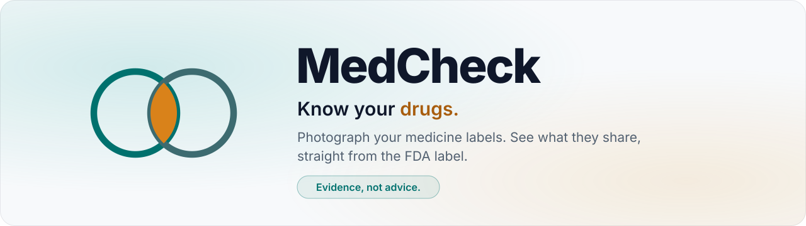
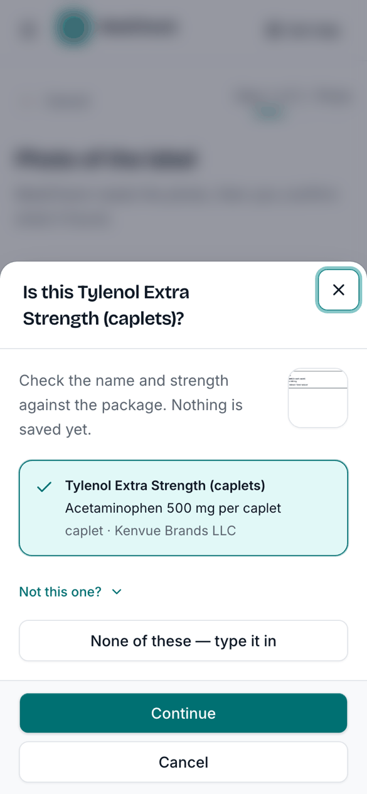
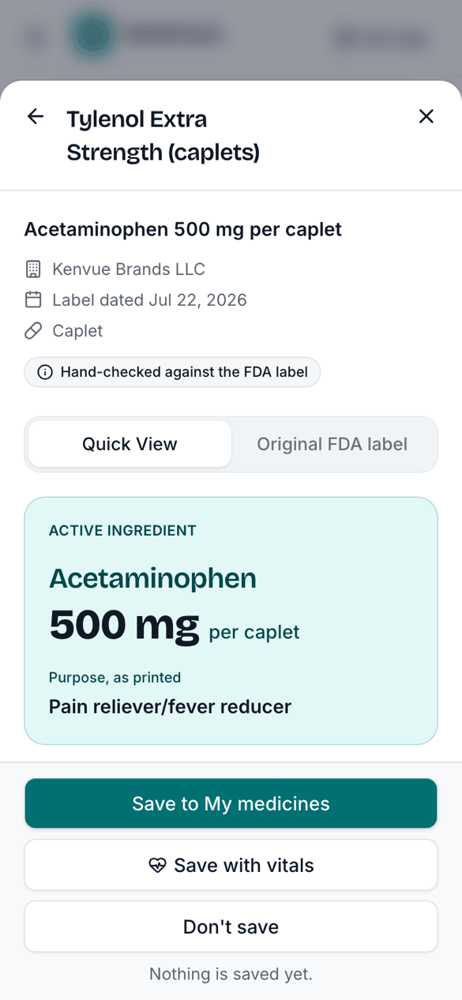
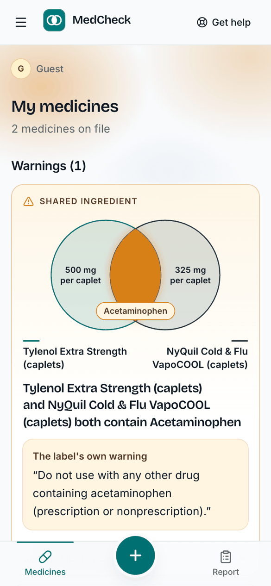
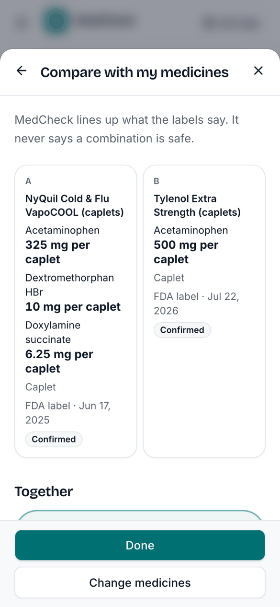
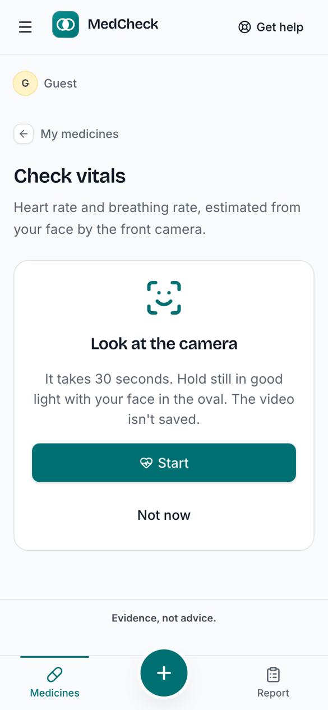
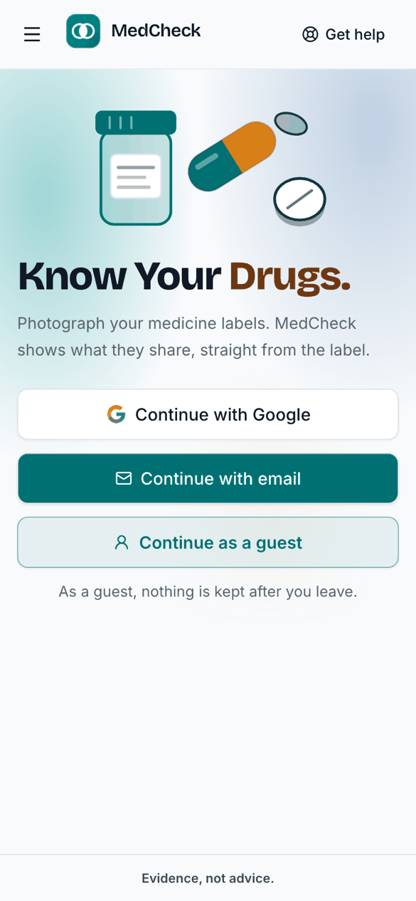
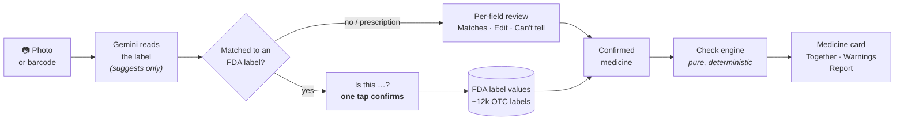
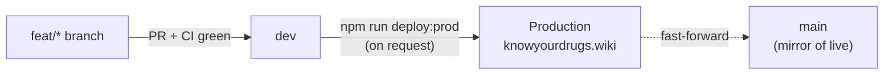

<div align="center">

<picture>
  <source media="(prefers-color-scheme: dark)" srcset="docs/assets/banner-dark.svg">
  
</picture>

<p>
  <a href="https://knowyourdrugs.wiki"></a>
  <a href="https://github.com/bibeshpyakurel/MedCheck/actions/workflows/ci.yml"></a>
  
  
  
  
  
  <a href="LICENSE"></a>
</p>

**One photo of your medicines → every shared ingredient, in the FDA label's own words.**

[**Try it live**](https://knowyourdrugs.wiki) ([mirror](https://medcheck-six.vercel.app)) · [How it works](#how-it-works) · [Quick start](#quick-start) · [Architecture](docs/architecture.md) · [Docs](docs/README.md) · [Contributing](CONTRIBUTING.md)

</div>

---

MedCheck is a phone-first web app for anyone managing medicines, especially caregivers. Take one photo, and MedCheck works out which over-the-counter medicines are in it. It matches each one to its FDA label (the catalog holds about 12,000 US oral OTC labels) and shows you:

- what each label says,
- when two medicines share an active ingredient or belong to the same family,
- where strengths or units disagree.

Every finding is a plain-English warning built from the label's own words.

> [!IMPORTANT]
> **Evidence, not advice.** MedCheck never calculates a dose, never says a combination is "safe", and never picks which product or amount is right. It shows what the labels say, so you can take a sharper question to a pharmacist or doctor. If you've already given two medicines and are worried, call **Poison Control at 1-800-222-1222**. That number is behind **Get help** on every page.

## See it in action

<table>
  <tr>
    <td align="center" width="33%">
      <picture>
        <source media="(prefers-color-scheme: dark)" srcset="docs/assets/screenshots/confirm-dark.png">
        
      </picture>
      <br><b>1. Snap a photo</b><br><sub>Gemini reads the package and asks "Is this …?". One tap confirms it.</sub>
    </td>
    <td align="center" width="33%">
      <picture>
        <source media="(prefers-color-scheme: dark)" srcset="docs/assets/screenshots/medicine-card-dark.png">
        
      </picture>
      <br><b>2. Read the label at a glance</b><br><sub>Ingredient, uses, directions by age, and warnings, all in the label's own words.</sub>
    </td>
    <td align="center" width="33%">
      <picture>
        <source media="(prefers-color-scheme: dark)" srcset="docs/assets/screenshots/warnings-dark.png">
        
      </picture>
      <br><b>3. See what overlaps</b><br><sub>Shared ingredients appear as a Venn diagram, with the label's own warning.</sub>
    </td>
  </tr>
  <tr>
    <td align="center">
      <picture>
        <source media="(prefers-color-scheme: dark)" srcset="docs/assets/screenshots/compare-dark.png">
        
      </picture>
      <br><b>4. Compare with my medicines</b><br><sub>Line any medicine up against the ones you've saved.</sub>
    </td>
    <td align="center">
      <picture>
        <source media="(prefers-color-scheme: dark)" srcset="docs/assets/screenshots/vitals-dark.png">
        
      </picture>
      <br><b>5. Save with vitals</b><br><sub>An optional 30-second face scan estimates heart and breathing rate.</sub>
    </td>
    <td align="center">
      <picture>
        <source media="(prefers-color-scheme: dark)" srcset="docs/assets/screenshots/landing-dark.png">
        
      </picture>
      <br><b>6. Start in seconds</b><br><sub>Sign in with Google or an email code, or try it as a guest.</sub>
    </td>
  </tr>
</table>

## Features

| | Feature | What it does |
|---|---|---|
| 📷 | **Photo answers** | One photo, read as soon as it's taken. For one medicine, MedCheck asks "Is this …?" and then opens its card. For two or more, it confirms each one and shows **Together**: a Venn diagram (or a grid for 3+) of shared ingredients and same-family pairs. |
| 🏷️ | **Barcode and NDC lookup** | Scan a barcode or type an NDC. MedCheck finds the one FDA label with that code and opens its card. Gemini isn't involved. |
| 💊 | **Medicine card** | A dashboard over the FDA label: an ingredient card, uses as tiles, directions grouped by age with amounts highlighted in place, and every warning as its own card. The **Original FDA label** tab shows the label as published. |
| ⚖️ | **Compare with my medicines** | Pick any saved medicines and see side-by-side cards, the **Together** diagram, and label-backed findings. Each finding comes with a pharmacist question you can copy. |
| ⚠️ | **Warnings engine** | Deterministic checks over *confirmed* values only: shared ingredient, same family, same medicine listed twice, different concentrations, mismatched units, and listing vs. package. |
| 📝 | **Prescriptions and discharge lists** | These aren't in the OTC catalog, so they open a per-field review instead: label crop, AI value, then **Matches** / **Edit** / **Can't tell**. |
| ❤️ | **Save with vitals** | After saving, an optional [VitalLens](https://www.rouast.com/api/) face scan estimates heart rate and breathing rate. MedCheck stores only the numbers, never video, frames or face data. |
| 📄 | **Medicine report** | Preview, download as PDF, share, or email a report of your medicines, warnings and latest vitals. |
| 🔐 | **Private by default** | Sign in with Google, an email one-time code, or as a guest. Every table has row-level security. A guest's data is deleted when they leave. |

## How it works



Three rules hold everywhere:

1. **AI only suggests.** Gemini reads the photo and suggests a product. A value counts only after you confirm or edit it. Anything `pending` or `unknown` leaves a check `unresolved`; it never passes.
2. **The label's own words.** Card text is the FDA label split into bullets by code, never reworded or AI-written. A children's dosing table is always shown whole, with no row highlighted.
3. **Never "safe".** When nothing is found, MedCheck says "No … found in confirmed fields". It never says "safe" and never shows green.

## Tech stack

| Layer | Choice |
|---|---|
| App | [Next.js 16](https://nextjs.org) App Router, React 19, TypeScript, Tailwind CSS 4, [shadcn/ui](https://ui.shadcn.com) on Base UI, Motion |
| Data and auth | [Supabase](https://supabase.com): Postgres with row-level security, Auth (Google, email one-time code, anonymous guest), a private Storage bucket for label photos |
| AI | Gemini (Flash tier) through the [AI SDK](https://ai-sdk.dev), with structured output validated by zod and a fallback model |
| Drug data | [openFDA](https://open.fda.gov) Drug Label and NDC Directory, imported into the catalog; [DailyMed](https://dailymed.nlm.nih.gov) and [MedlinePlus](https://medlineplus.gov) links |
| Scanning | The device's `BarcodeDetector`, with [ZXing](https://github.com/zxing-js/browser) as the fallback |
| Vitals | [VitalLens](https://www.rouast.com/api/) API through a signed-in server proxy |
| Reports | `@react-pdf/renderer` (server-side PDF) and [Resend](https://resend.com) (optional email) |
| Quality | Vitest unit tests, Playwright end-to-end tests with a fake Gemini, and GitHub Actions on every PR |
| Hosting | [Vercel](https://vercel.com). Deploys are manual (see [Deployment](#deployment)) |

## Quick start

**Prerequisites:** Node.js ≥ 24, npm, and keys for a Supabase project and Google AI Studio.

```bash
git clone https://github.com/bibeshpyakurel/MedCheck.git
cd MedCheck
npm install
cp .env.example .env.local     # fill in the keys below (team members: `vercel env pull .env.local`)
npm run dev                    # http://localhost:3000
```

> [!TIP]
> Phones only allow the camera over HTTPS. To test on a phone, run `npm run dev -- --experimental-https` or use a tunnel.

### Environment variables

| Variable | Required | Purpose |
|---|:---:|---|
| `NEXT_PUBLIC_SUPABASE_URL` | ✅ | Supabase project URL |
| `NEXT_PUBLIC_SUPABASE_PUBLISHABLE_KEY` | ✅ | Supabase publishable (browser) key |
| `GOOGLE_GENERATIVE_AI_API_KEY` | ✅ | Gemini key from Google AI Studio |
| `GEMINI_MODEL` / `GEMINI_FALLBACK_MODEL` | — | Primary model id, and the model tried when it fails (`none` disables the fallback). Both have defaults |
| `SUPABASE_SECRET_KEY` | — | Server only, never at runtime: catalog import and seeding, e2e cleanup |
| `VITALLENS_API_KEY` | — | Server only: turns on the vitals scan |
| `RESEND_API_KEY` / `EMAIL_FROM` | — | Turns on **Send by email** from MedCheck's own address |

The Google sign-in provider and the SMTP sender for email codes are set in the Supabase dashboard, not in env. See [`AGENTS.md` § Supabase Auth](AGENTS.md#supabase-auth).

### Scripts

| Command | What it does |
|---|---|
| `npm run dev` | Start the dev server |
| `npm run build` / `npm start` | Production build and serve |
| `npm run lint` · `npm run typecheck` · `npm test` | ESLint, `tsc`, Vitest |
| `npm run e2e` | Playwright end-to-end suite (uses the fake Gemini in `e2e/`) |
| `npm run db:types` | Regenerate `src/lib/supabase/database.types.ts` from the linked project |
| `npm run import:otc` | Import or refresh the US OTC catalog from openFDA (`-- --dry-run` writes nothing) |
| `npm run seed` | Seed the hand-checked catalog rows |
| `npm run deploy:prod` | Deploy `origin/dev` to production. Maintainers only, and only on request |

## Project structure

```text
src/
├── app/                      # Next.js routes, server actions, API routes
│   ├── patients/[patientId]/ #   My medicines, add (photo/scan), entries, compare, export, vitals
│   └── api/                  #   catalog search, extraction, report PDF, email, VitalLens proxy
├── components/               # UI: medicine-card, photo-answers, compare, warnings, vitals, ui (shadcn)
└── lib/
    ├── domain/               # The shared contract (zod schema), ingredient normalization, families
    ├── checks/               # The check engine: pure, test-first rules → findings
    ├── fda/                  # openFDA import: label sections, strengths, NDC join
    ├── ai/                   # Gemini extraction (read as printed, the user confirms)
    ├── report/               # Report builder, PDF, email config
    └── *.ts                  # Flow decisions (photo-flow, compare-view, medication-facts, vitals …)
supabase/migrations/          # Schema; every table has RLS
e2e/                          # Playwright specs and the fake Gemini server
docs/                         # Architecture, design specs, plans
```

The full module map, with what lives where and which helpers to reuse, is in [`AGENTS.md` § Code map](AGENTS.md#code-map). The system design is in [`docs/architecture.md`](docs/architecture.md).

## Testing

```bash
npm run lint && npm run typecheck && npm test && npm run build   # the pre-push gate (same as CI)
E2E_PORT=3100 FAKE_GEMINI_PORT=4900 npm run e2e                  # end-to-end, on ports of your own
```

- **Unit:** pure logic (checks, matching, label parsing, vitals, report) has Vitest tests next to it, written first.
- **End-to-end:** Playwright drives a production build on a 390 px phone and a 1280 px desktop. A local fake Gemini picks a canned read by the photo's width, so no tests spend model quota, and the suite never starts a vitals scan.
- **CI:** every PR into `dev` runs `verify` (lint, typecheck, unit tests, build) and `e2e`. Both must pass before merging.

> [!WARNING]
> Local runs and e2e use the same Supabase project as production. Create data only as guest users and delete what you create. The e2e suite cleans up after itself.

## Deployment



`dev` is the working branch. Vercel never deploys on push, PR or merge. Production is deployed by hand from `origin/dev` with `npm run deploy:prod`, which then fast-forwards `main` to the live commit. Never push to `main` directly. Details are in [`CONTRIBUTING.md`](CONTRIBUTING.md) and [`AGENTS.md` § Git](AGENTS.md#git).

## Documentation

| Doc | For |
|---|---|
| [`docs/README.md`](docs/README.md) | The documentation index: every spec and plan, with what it covers |
| [`docs/architecture.md`](docs/architecture.md) | System overview, data model, request flows, check engine |
| [`CONTRIBUTING.md`](CONTRIBUTING.md) | Branching, checks, conventions and product boundaries for contributors |
| [`SECURITY.md`](SECURITY.md) | How to report a vulnerability, and how MedCheck handles data |
| [`AGENTS.md`](AGENTS.md) | Rules and the code map for AI coding agents (and a handy reference for humans) |

## Data sources and acknowledgements

- **[openFDA](https://open.fda.gov)**: the Drug Label and NDC Directory datasets (public domain) behind the catalog.
- **[DailyMed](https://dailymed.nlm.nih.gov)** (NLM) for each label's source link, and **[MedlinePlus](https://medlineplus.gov)** (NIH) for ingredient pages. These are links only; their text isn't copied.
- **[VitalLens](https://www.rouast.com/api/)** by Rouast Labs for vitals estimation.
- Statistics on the in-app *Why it matters* page come from AARP (2025).

## License

[MIT](LICENSE) © 2026 Bibesh Pyakurel. The FDA label data is public domain. VitalLens, Gemini and the other third-party services keep their own terms.

<div align="center">
<sub>MedCheck is for general information and wellness. It is not a medical device and does not give medical advice.<br>Always follow the label, and ask a pharmacist or doctor about your medicines.</sub>
</div>
