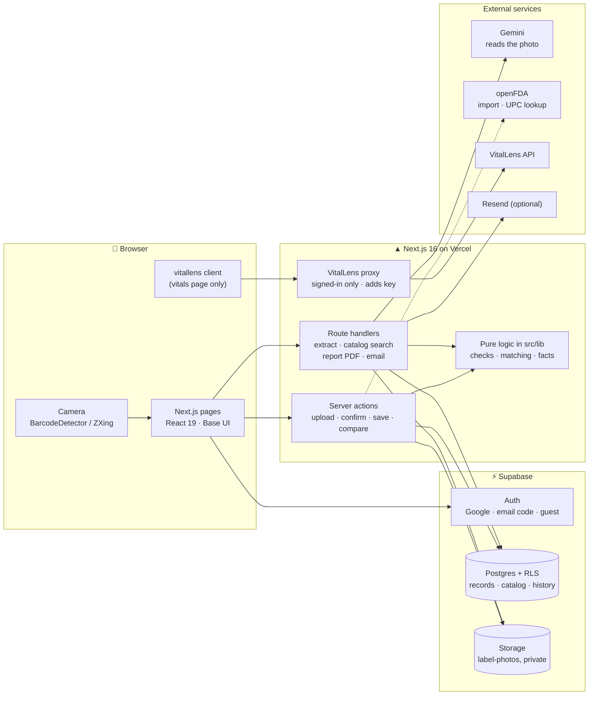
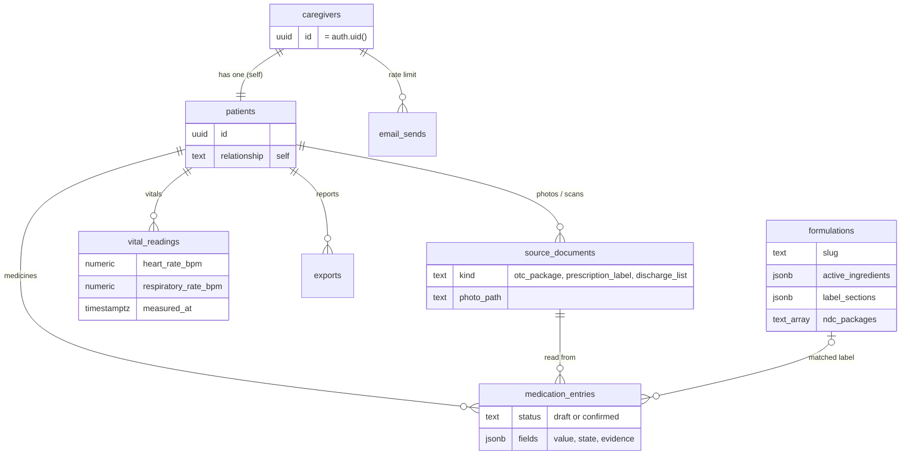
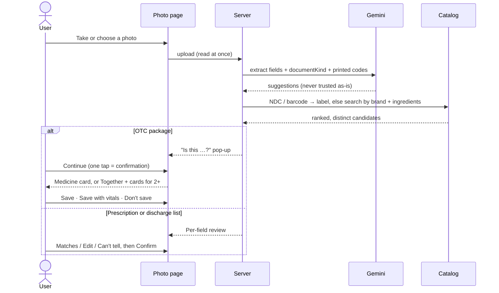
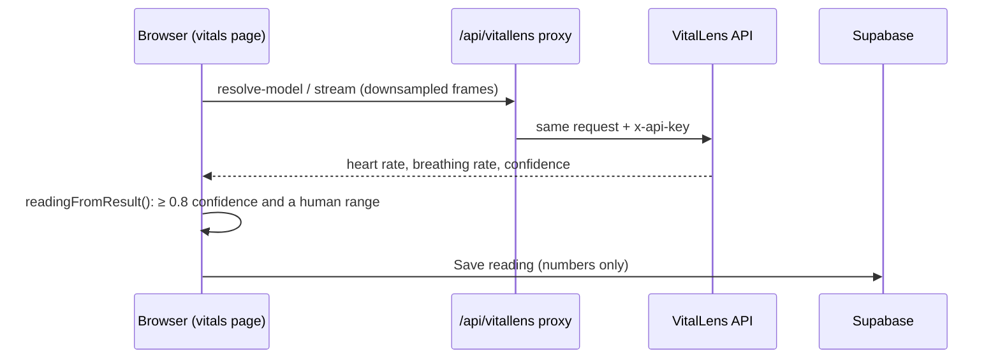

# Architecture

How MedCheck fits together, for someone opening the codebase for the first time. The design specs in [`superpowers/specs/`](superpowers/specs/) hold the reasoning behind each feature. [`AGENTS.md`](../AGENTS.md) holds the module-by-module code map.

- [System overview](#system-overview)
- [Data model](#data-model)
- [The photo flow](#the-photo-flow)
- [The check engine](#the-check-engine)
- [The catalog](#the-catalog)
- [Vitals](#vitals)
- [Security model](#security-model)
- [Design principles in code](#design-principles-in-code)

## System overview

| Concern | Where |
|---|---|
| Routes and pages | `src/app/` (App Router). Middleware is `src/proxy.ts` |
| Shared contract | `src/lib/domain/schema.ts` (zod schemas and types every feature builds on) |
| Data access | `src/lib/records.ts` (runs as the user) and `src/lib/catalog.ts` (catalog reads) |
| Supabase clients | `src/lib/supabase/{client,server,proxy}.ts` |
| AI | `src/lib/ai/`. Gemini is used only to read a photo, and the user confirms every read |

## Data model

Every patient-scoped table is protected by row-level security: a user reads and writes only rows under their own patient. The catalog is public read and server write.

- **`history`** is an append-only change log. Triggers on `patients`, `medication_entries`, `source_documents` and `vital_readings` write to it, and it feeds the activity list on My medicines.
- **`medication_entries.fields`** follows `EntryFields`. Each field holds the AI's suggestion, a `state` (`pending` | `confirmed` | `edited` | `unknown`) and its evidence. Only `confirmed` and `edited` values count.
- Migrations live in [`supabase/migrations/`](../supabase/migrations/). Generated types are in `src/lib/supabase/database.types.ts` (`npm run db:types`).

## The photo flow

- The user never picks the photo's kind. Gemini returns `documentKind`, and `otc_package` is the default when it's unsure.
- Nothing is saved as confirmed until the user acts. **Don't save** deletes the read, its drafts and the photo.
- The decisions are pure functions: `src/lib/photo-flow.ts` and `src/lib/photo-answers.ts` decide where to go next, and `src/lib/match-groups.ts` collapses duplicate catalog rows. The pop-up UI is in `src/components/photo-answers/`.

## The check engine

`src/lib/checks/` is a set of pure, deterministic functions. Each takes the person's confirmed entries plus their catalog labels and returns a `CheckRun` per check. The Medicines page, the compare sheet and the report all call the same `runChecks()`, so they can never disagree.

| Check | Finds |
|---|---|
| `ingredient_overlap` | Two distinct products share a normalized active ingredient |
| `ingredient_family` | Different ingredients in one reviewed family (NSAIDs, antihistamines, nasal decongestants, acid reducers, sleep aids). Raised only when a label's own words support it |
| `repeated_record` | The same product entered twice (a repeat, not an overlap) |
| `concentration` | Two liquids with the same ingredient but different mg per mL. Both are stated as printed, and no volume is ever suggested |
| `units` | Instructions and strength use units that don't line up |
| `database_vs_box` | The FDA listing and the confirmed package values differ |

Each run ends as `finding`, `no_finding`, `unresolved` (a needed field is `pending` or `unknown`) or `not_applicable`. A `no_finding` reads "None found in confirmed fields". It is never shown as safe or green.

Ingredient names all go through `normalizeIngredient()` (`src/lib/domain/ingredients.ts`). It is a fixed, reviewed synonym table with no external normalization service, so it is deterministic, testable and works offline.

## The catalog

- About **12,000** US oral OTC labels (oral, sublingual and buccal routes; no homeopathic products or kits), one row per FDA label (`openfda_set_id`).
- Built by `npm run import:otc`, which joins openFDA's Drug Label and NDC Directory. It's idempotent, and `--dry-run` writes nothing. Hand-checked seed rows (`npm run seed`) win over imported ones.
- `label_sections` holds each Drug Facts section split into bullets by code (`src/lib/fda/sections.ts`), never reworded.
- Requests never load the whole catalog. They search it with the `search_formulations` RPC (trigram index on brand and generic name).
- `findFormulationByCodes()` turns an NDC or barcode into its one label: catalog package NDCs first, then openFDA by UPC.

## Vitals

- The proxy only forwards `GET resolve-model` and `POST stream`, and only for a signed-in user. The API key stays on the server.
- MedCheck stores **no video, frames or face data**: only `vital_readings` numbers.
- Wording comes only from `vitalLines()` and `VITALS_NOTE` in `src/lib/vitals.ts`. A value under 0.8 confidence shows "Couldn't read clearly". Readings are never judged ("normal", "high") or linked to a medicine.

## Security model

| Layer | Control |
|---|---|
| Database | RLS on every table. Patient rows are reachable only through the owning `auth.uid()` |
| Storage | `label-photos` is private. A user can reach only their own folder (`<uid>/…`) |
| Secrets | Server-only modules start with `import "server-only"`. Secrets are never in `NEXT_PUBLIC_*` |
| Guests | Anonymous sign-in. **Leave guest session** deletes the guest's data, and the browser warns before closing a guest tab |
| Abuse limits | Email reports are rate-limited per account per day, and the vitals proxy needs a signed-in session |

See [`SECURITY.md`](../SECURITY.md) for how to report a vulnerability.

## Design principles in code

| Principle | How the code holds it |
|---|---|
| Evidence, not advice | No module computes a dose, volume or schedule. Strengths sit side by side and are never summed |
| AI only suggests | `EntryFields` state machine. Checks skip anything not confirmed |
| The label's own words | Every line on the medicine card is a `LabelLine` whose `ref` points at its raw label bullet. A test checks this for every fixture label |
| One engine | `runChecks()` is the only source of findings, shared by every screen |
| Test-first | Pure logic has a Vitest file next to it (`*.test.ts`). Playwright covers the flows with a fake Gemini |
